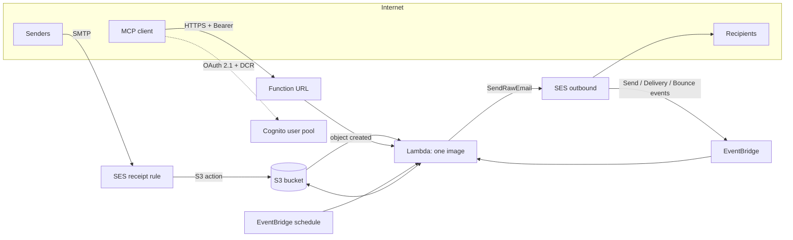

# Serverless Mailbox with an MCP Interface — Design

## 1. Summary

A personal mailbox on AWS, used through an MCP server:

- **Inbound:** mail to a domain whose MX points at SES is stored in S3, parsed into body text and attachments, and made searchable.
- **Outbound:** sending goes through an S3 outbox, is processed asynchronously and reconciled against SES events, and the sent copy is stored with the inbound mail.
- **Search:** a SQLite FTS5 index kept as a file in S3, rebuilt in batches. Messages not yet indexed are scanned directly from S3 at query time.
- **Organization:** tags, which also give you folders and archive (`inbox` is a tag; archiving removes it).
- **Access:** a remote MCP server (streamable HTTP, stateless JSON responses) on a Lambda Function URL. Auth is OAuth 2.1 against a Cognito user pool with dynamic client registration and email-OTP sign-in.
- **Code:** one Lambda container image that handles every flow, plus Terraform/OpenTofu. Deployed from GitHub Actions through OIDC.
- **Expected cost:** about $0.30/month at ~2,400 inbound messages a month.

Nothing runs continuously. Every cost is per request or per GB stored.

**Fixed parameters**

| | |
|---|---|
| Mail domain | `ncolony.org` |
| Region | `us-east-2` (Ohio) |
| DNS | Cloudflare, records managed by Terraform |
| Backfill | None. The mailbox starts empty. |

---

## 2. Architecture



### 2.1 One function, five flows

The handler picks a flow from the shape of the incoming event. No routing arguments are needed.

| Trigger | How it's recognized | Flow |
|---|---|---|
| S3 `ObjectCreated` under `inbound/` | S3 event, key prefix | **Ingest**: parse and store a received message |
| S3 `ObjectCreated` for `outbox/*/message.eml` | S3 event, key prefix and suffix | **Activate**: claim and send an outbox message |
| EventBridge, `source = aws.ses` | event `source` | **Confirm**: record Send/Delivery/Bounce, write the sent copy |
| EventBridge scheduled event | `detail-type = Scheduled Event` | **Reconcile + index backstop** |
| Function URL request | `requestContext.http` present | **MCP** |
| Async self-invoke `{"action": "index"}` | custom payload | **Batch index** |

**Trade-off:** a single function has a single IAM role, so that role holds the union of the permissions every flow needs.

---

## 3. Storage layout (S3)

One bucket, versioning enabled.

```
inbound/{ses-message-id}               raw mail as written by the SES S3 action
msgs/{ulid}/raw.eml                    canonical raw message (inbound or sent)
msgs/{ulid}/body.txt                   extracted text (text/plain, else HTML→text)
msgs/{ulid}/headers.json               parsed headers: from, to, cc, subject, date,
                                       message-id, in-reply-to, references
msgs/{ulid}/attachments/0-body.html    the text/html body, if any, as UTF-8, with
                                       cid: references rewritten to local names
msgs/{ulid}/attachments/{n}-{name}     decoded attachments (n from 1), then every
                                       other part with a Content-ID (inline images)
msgs/{ulid}/meta.json                  tags, direction (in|out), status, s3 keys,
                                       unresolved_cids (only when there are any)
outbox/{ulid}/state.json               outbox state machine (see §5)
outbox/{ulid}/message.eml              MIME to send
unindexed/{ulid}                       zero-byte marker: message not yet in the index
dirty/{ulid}                           zero-byte marker: meta changed since last index
index/index-{yyyy}.db                  SQLite FTS5 shards, one per year
```

- **IDs** are ULIDs, so keys sort by time and the tail scan can list in order.
- **`attachments/`** holds three kinds of file, recorded as `kind` in the `headers.json` attachment list:
  - `body`: `0-body.html`. The `0-` prefix is reserved for it. Plain-text-only messages have none.
  - `attachment`: what `iter_attachments()` yields, numbered from 1 in that order.
  - `inline`: every other non-multipart part with a Content-ID (the inline parts of a `multipart/related` body), numbered after the attachments in MIME order. Attached `message/rfc822` parts are not entered.
  - A part with a file name keeps it (sanitized). A part with a Content-ID and no file name is `{n}-inline-{k}.{ext}`, with `k` counting such parts from 1 and the extension from the MIME type (Python's built-in table, so it does not vary by host). Any other unnamed part is `{n}-part{n}`.
  - Only `attachment` entries count for `has_attachments` and the indexed attachment names, so search behaves as before.
- **`0-body.html`** renders from local files: download it and the files it names into one directory and open it. Every `cid:` reference in `src`, `href` and `background` attributes and in CSS `url()` (inline `style` attributes and `<style>` blocks) is rewritten to the bare stored name, e.g. `src="cid:logo123@x"` → `src="2-logo.png"`. Matching URL-decodes the reference, strips the Content-ID's angle brackets and ignores case. A reference that matches no part is left as it is and listed in `meta.json` under `unresolved_cids`. The HTML is decoded with the part's declared charset and stored as UTF-8, and a `<meta>` charset declaration is changed to `utf-8` to match.
- **`meta.json`** is the source of truth for tags and status. The index is a derived cache, rebuildable from `msgs/`.
- **Every read-modify-write** of a JSON or index object uses S3 conditional writes (`If-Match: <etag>`). New objects that must not already exist use `If-None-Match: *`.

### 3.1 Retention (lifecycle rules)

Three kinds of objects are duplicates or history once their job is done:

| Prefix / object | Why it exists | After its job is done | Rule |
|---|---|---|---|
| `inbound/` | SES's raw drop. Ingest copies the same bytes to `msgs/{ulid}/raw.eml` | A safety net: lets you re-run ingest if a parser bug mangled something | Expire after **30 days** |
| `outbox/` | Outbox state machine and MIME | Once `sent`/`bounced`, the canonical copy is in `msgs/`; this is only audit trail | Expire after **30 days** |
| Noncurrent versions (whole bucket) | Versioning keeps every overwritten version | Every CAS write (`meta.json`, `state.json`) and every index shard rewrite leaves an old version | Expire noncurrent versions after **7 days** |

The last row matters most. Without it, every batch run keeps a full copy of the old shard, so stored bytes grow with (shard size × number of runs) instead of with mail volume.

`msgs/` and `index/` current versions are never expired.

---

## 4. Inbound flow

1. **SES receipt rule** for the mail domain, with one action: deliver to S3 at `inbound/`. Mail over 40 MB (including headers) bounces at SES.
2. **Ingest** runs on the S3 event:
   - Parse the MIME with Python's `email` package (`policy.default`).
   - Allocate a ULID and write `raw.eml`, `headers.json`, `body.txt` and everything under `attachments/` (see §3):
     - `body.txt` is unchanged: `text/plain`, else HTML→text.
     - If `msg.get_body(preferencelist=('html',))` finds an HTML body, write it as `attachments/0-body.html`, with its `cid:` references rewritten to the stored names of the inline parts.
     - Write the attachments from `iter_attachments()`, numbered from 1, then every other part with a Content-ID, including the inline parts that `get_body`/`iter_attachments` treat as part of the body.
     - Names depend only on the message bytes, so a re-ingest writes the same keys.
   - Write `meta.json` with `{"tags": ["inbox"], "direction": "in"}` (plus `unresolved_cids` when the HTML has `cid:` references that match no part), using `If-None-Match: *`. Because S3 events are at-least-once, a duplicate ingest is detected and dropped.
   - Write `unindexed/{ulid}`.
   - **Threshold check:** LIST `unindexed/` and `dirty/` (one call each). If the total is ≥ 100, invoke the batch indexer asynchronously.
3. Leave `inbound/{id}` in place. A lifecycle rule expires it (see §3.1).

To guard against the same message landing twice under different ULIDs (an SES retry, say), keep an `inbound-seen/{ses-message-id}` marker written with `If-None-Match: *` before allocating the ULID.

---

## 5. Outbound flow (transactional outbox)

SES `SendEmail` has no idempotency key. The design keeps duplicate sends rare and makes the one unavoidable ambiguity explicit.

### 5.1 State machine (`outbox/{ulid}/state.json`)

```
pending ──claim (CAS)──▶ sending ──SES Send event──▶ sent ──Delivery──▶ delivered
   ▲                        │                          └──Bounce──▶ bounced
   └──reconciler (stale, no Send event)──┘
```

### 5.2 Steps

1. **`send_email` (MCP tool):**
   - Build the MIME. For replies, set `In-Reply-To`/`References` from the stored original.
   - `From` is the configured `FROM_ADDRESS` unless the `from` argument names another address under `mail_domain` (bare, which keeps the configured display name, or `Name <address>`). Other domains and line breaks are rejected. SES sends against the domain identity and the receipt rule takes the whole domain, so no infra change is needed for a new local part.
   - Add `X-SES-CONFIGURATION-SET: <set>` and `X-SES-MESSAGE-TAGS: outbox_id=<ulid>`. SES strips both before sending.
   - Write `state.json` = `pending` first, then `message.eml`.
   - Write `msgs/`-style records for the outbox copy with the tag `outbox`, plus an `unindexed/` marker, so queued mail is searchable.
   - Return the outbox ID immediately.
2. **Activate** fires on `message.eml` created. Only that key is in the notification filter, so state updates don't re-trigger it.
   - Read `state.json`. If it isn't `pending`, exit.
   - CAS `state.json` → `sending` (with a timestamp). A losing CAS means another invocation won; exit.
   - Call `SendRawEmail` (SES v2) with the configuration set.
3. **Confirm** runs on the SES `Send` event from EventBridge:
   - Read `outbox_id` from the event tags. CAS the state to `sent` and record the SES message ID.
   - Write the final sent copy to `msgs/{ulid}/raw.eml`, with `Message-ID` rewritten to `<{ses-message-id}@{region-specific amazonses.com domain}>`. SES rewrites the outgoing Message-ID, so without this, replies won't thread. Check the exact domain format once against a real sent message, then hardcode it.
   - Swap tags `outbox` → `sent` in `meta.json` and write a `dirty/` marker.
   - `Delivery` and `Bounce` events update the state (and add a `bounced` tag) the same way.
4. **Reconciler** (scheduled every **15 minutes**; staleness threshold **30 minutes**):
   - `pending` older than 30 minutes was never claimed. Re-trigger activation.
   - `sending` older than 30 minutes with no Send event means SES never accepted it. CAS back to `pending`. **This is the only path to a duplicate send:** a Send event more than 30 minutes late, rather than missing, would cause one.

### 5.3 Sending constraints

- The account must be out of the **SES sandbox** to send to unverified recipients (see §11).
- Maximum message size is 40 MB with the v2 API or SMTP.

---

## 6. Search

### 6.1 Index format

SQLite with FTS5, sharded by year: `index/index-{yyyy}.db`.

```sql
CREATE TABLE messages (
  id TEXT PRIMARY KEY,          -- ULID
  message_id TEXT,
  in_reply_to TEXT,
  date INTEGER,                 -- epoch seconds
  direction TEXT,               -- 'in' | 'out'
  from_addr TEXT,
  to_addrs TEXT,
  cc_addrs TEXT,
  subject TEXT,
  tags TEXT,                    -- JSON array; also exploded into message_tags
  has_attachments INTEGER
);
CREATE TABLE message_tags (id TEXT, tag TEXT, PRIMARY KEY (tag, id));
CREATE VIRTUAL TABLE fts USING fts5(
  subject, from_addr, to_addrs, body, attachment_names,
  content='', tokenize='unicode61'
);
```

Results are ranked with FTS5's built-in `bm25()`.

### 6.2 Batch indexer

- **Triggers:** the ingest threshold (`unindexed/` + `dirty/` ≥ 100), plus a daily scheduled backstop.
- **Per affected shard:**
  - GET the shard and remember its ETag.
  - Upsert every message in `unindexed/` and `dirty/` from S3 (`headers.json`, `body.txt`, `meta.json`).
  - `VACUUM` occasionally.
  - PUT with `If-Match: <etag>`. On 412, re-download and retry.
- **After a successful PUT,** delete the markers it processed.
- **Concurrent runs** are harmless: upserts are keyed by ULID, and the CAS serializes the writes.

### 6.3 Query path (`search` tool)

1. **Index:**
   - Shards are cached in `/tmp` across warm invocations. Revalidate each with a conditional GET (`If-None-Match: <etag>`); an unchanged shard costs one request.
   - Query newest shards first, in parallel.
   - Drop any hit whose ID currently has a `dirty/` marker, since the index copy is stale.
2. **Tail:**
   - LIST `unindexed/` and `dirty/` (bounded at ~100 entries by the threshold).
   - Fetch those messages' `headers.json`, `body.txt` and `meta.json` with a thread pool.
   - Match them in Python using the same query language: terms plus structured filters.
3. **Merge:**
   - Ranked index hits first, then tail hits by date, labeled unranked.
   - Dedupe by ULID, since a message can show up on both sides if indexing runs mid-search.

**Keep the query language minimal** (terms, `from`, `to`, `after`, `before`, `tags`, `has_attachments`) so the naive tail matcher and FTS5 agree.

### 6.4 Sizing

- Text plus the FTS index is tens of MB per year at the current volume. With no backfill, the first shard starts empty.
- Per-year shards keep each download small. Past years' shards never change, so they stay cached and are almost never re-downloaded.
- The default 512 MB of Lambda ephemeral storage is enough for years. It's configurable up to 10 GB.

---

## 7. Tags (folders and archive)

- **New inbound mail** gets `inbox`. Archiving means removing `inbox`, and a folder is just a tag.
- **System tags:** `inbox`, `sent`, `outbox`, `bounced`.
- **`tag_email(id, add, remove)`:**
  - CAS-update `meta.json`, then write `dirty/{ulid}`.
  - It never touches the index directly.
- **Freshness:** search treats dirty messages as tail items, so tag changes show up immediately.
- **Listing tags:** `list_tags` aggregates `message_tags` from the shards, plus the tail.

---

## 8. MCP server

### 8.1 Transport

- **Streamable HTTP** in **stateless mode with JSON responses** (`stateless_http=True, json_response=True` in the Python SDK).
- **Why stateless:** Lambda supports response streaming only on Node.js managed runtimes. Every tool here is plain request/response, so streaming isn't needed.
- **Hosting:** a Lambda Function URL with auth type `NONE`. The function validates OAuth itself.

### 8.2 Tools

| Tool | Arguments | Returns |
|---|---|---|
| `search` | `query`, `from?`, `to?`, `after?`, `before?`, `tags?`, `has_attachments?`, `limit?` | list of `{id, date, from, subject, snippet, tags, ranked}` |
| `get_message` | `id` | headers, body text, attachment list, tags. The attachment list (`headers.attachments`) has `{name, content_type, size, kind}` for every file under `attachments/`: `0-body.html` (kind `body`) first when the message has an HTML body, then attachments (`attachment`), then inline parts (`inline`) |
| `get_attachment` | `id`, `name` | short-lived presigned S3 URL. Bytes would hit Lambda's response-size limit. Works for any listed name, `0-body.html` included |
| `send_email` | `to`, `cc?`, `bcc?`, `subject`, `body`, `in_reply_to_id?`, `from?` (sender under `mail_domain`), `attach_from?` (existing attachment refs) | outbox ID |
| `tag_email` | `id`, `add?`, `remove?` | new tag set |
| `list_tags` | — | tags with counts |
| `get_session_token` | — | `{token, expires_at, endpoint}`: a 5-minute bearer token for scripts (§9.3) |

To see what's queued or stuck, search for `tags=["outbox"]`.

---

## 9. Authentication

### 9.1 Protocol

- **The MCP server is an OAuth 2.1 resource server.** It serves `/.well-known/oauth-protected-resource` (RFC 9728), naming the Cognito user pool as its authorization server.
- **Every request** carries `Authorization: Bearer <access token>`. The Lambda checks:
  - the signature, against Cognito's JWKS (cached),
  - the issuer, expiry, and `token_use = access`,
  - the required scope (e.g. `mail/full`).
- **Don't pin a client ID.** With dynamic client registration, each MCP client gets its own.

### 9.2 Cognito setup

- **Pool:** a user pool on the Essentials plan (the default for new pools; free under 10,000 monthly active users). It has one user: your email address.
- **Sign-in:** email OTP as the first factor. No password is ever set.
  - This requires **managed login**, because the classic hosted UI doesn't support passwordless flows.
  - Codes go out through Cognito's default email sender (50 messages a day; plenty for one user).
- **Domain:** the prefix domain `<prefix>.auth.<region>.amazoncognito.com`. It needs no certificate and no DNS.
- **Scopes:** a resource server defining `mail/full`.
- **Dynamic client registration** (RFC 7591) is enabled on the pool, so MCP clients register themselves.
  - It shipped in Cognito in November 2026. If the Terraform AWS provider doesn't support the setting yet, set it with an `aws` CLI `local-exec`.
  - Open registration lets anyone register a client. They still can't get a token without signing in as the pool's only user.

### 9.3 Session tokens (scripts)

- `get_session_token` mints an HS256 JWT (`iss = pidge-session`, `aud` = the MCP endpoint URL, `exp` = now + 5 minutes) so a script can call the endpoint directly with `Authorization: Bearer <token>`.
- The signing key is a 64-character random value in the SSM SecureString `/pidge/session-signing-key` (Terraform `random_password`, encrypted with `aws/ssm`). The Lambda reads it on first use (env `SESSION_KEY_PARAMETER`).
- The endpoint routes by the token header: `alg = HS256` goes to the session validator, anything else to the Cognito validator. A valid session token gets every tool, the same as a Cognito token with `mail/full`; expired, badly signed or mis-addressed ones get a 401.
- Nothing in front of the function checks tokens (the Function URL's auth type is `NONE`), so no AWS-side change was needed.

---

## 10. DNS (Cloudflare, managed by Terraform; no Route 53)

`ncolony.org` is hosted on Cloudflare (`amber.ns.cloudflare.com`). As of 2026-11-21 it has no MX, TXT or `_dmarc` records, so nothing conflicts.

The main stack manages these records with the Cloudflare provider (v5, resource `cloudflare_dns_record`). The DKIM tokens are wired directly from `aws_ses_domain_dkim`, so nothing gets copied by hand.

| Name | Type | Value | Purpose |
|---|---|---|---|
| `ncolony.org` | MX | `10 inbound-smtp.us-east-2.amazonaws.com` | SES receiving |
| `<t1>._domainkey.ncolony.org` | CNAME | `<t1>.dkim.amazonses.com` | Easy DKIM + domain verification |
| `<t2>._domainkey.ncolony.org` | CNAME | `<t2>.dkim.amazonses.com` | 〃 |
| `<t3>._domainkey.ncolony.org` | CNAME | `<t3>.dkim.amazonses.com` | 〃 |
| `bounce.ncolony.org` *(optional)* | MX | `10 feedback-smtp.us-east-2.amazonses.com` | custom MAIL FROM |
| `bounce.ncolony.org` *(optional)* | TXT | `"v=spf1 include:amazonses.com ~all"` | SPF alignment |
| `_dmarc.ncolony.org` | TXT | `"v=DMARC1; p=none;"` | DMARC |

Notes:

- **All records `proxied = false`.** MX and TXT can't be proxied, and a proxied DKIM CNAME would resolve to Cloudflare's edge instead of `dkim.amazonses.com`, so verification would fail.
- **Zone ID** comes from a `cloudflare_zone` data source looked up by name, or from a variable.
- **Credentials:** the provider reads `CLOUDFLARE_API_TOKEN` from the environment. Use a token scoped to **Zone → DNS → Edit** on the `ncolony.org` zone only.
- **Ordering:** SES verifies the domain once the DKIM CNAMEs resolve. The receipt rule doesn't depend on verification, so one apply creates everything. Verification completes on its own within minutes to hours.

Sketch:

```hcl
resource "cloudflare_dns_record" "mx" {
  zone_id  = data.cloudflare_zone.ncolony.zone_id
  name     = "ncolony.org"
  type     = "MX"
  content  = "inbound-smtp.us-east-2.amazonaws.com"
  priority = 10
  ttl      = 1        # automatic
  proxied  = false
}

resource "cloudflare_dns_record" "dkim" {
  count   = 3
  zone_id = data.cloudflare_zone.ncolony.zone_id
  name    = "${aws_ses_domain_dkim.this.dkim_tokens[count.index]}._domainkey.ncolony.org"
  type    = "CNAME"
  content = "${aws_ses_domain_dkim.this.dkim_tokens[count.index]}.dkim.amazonses.com"
  ttl     = 1
  proxied = false
}
```

---

## 11. Infrastructure (Terraform / OpenTofu)

### 11.1 Bootstrap stack

Applied once from a laptop with admin credentials. Local state is fine, or migrate it into the bucket it creates.

- S3 state bucket (versioned). The main stack's backend uses `use_lockfile = true` (S3-native locking, no DynamoDB).
- IAM OIDC provider for `token.actions.githubusercontent.com`, audience `sts.amazonaws.com`. No thumbprint needed.
- **Deploy role** with a trust policy matching:
  - `aud = sts.amazonaws.com`;
  - the repository **by immutable ID**, not by name. GitHub's `sub` claim now carries numeric owner and repo IDs, and slug-based policies break on new repos;
  - the `main` branch only.

  The role creates IAM roles, so it's effectively admin on the account. Optionally add a second, read-only role for `plan` on PRs.
- ECR repository. It lives here so the main stack's Lambda never references a repository that doesn't exist yet.

### 11.2 Main stack

- **Storage:** S3 bucket (versioning; lifecycle rules per §3.1). The bucket policy lets SES write to `inbound/`, and notifications go to the Lambda for `inbound/` and for the `outbox/` `message.eml` suffix.
- **Lambda:**
  - Function from an image, pinned by digest.
  - Ephemeral storage sized for the index shards.
  - Role and policy.
  - Function URL.
  - `aws_lambda_permission` for S3 and EventBridge.
  - The session-token signing key (`random_password` → SSM SecureString, §9.3).
- **SES:**
  - Domain identity plus `aws_ses_domain_dkim`.
  - Optional MAIL FROM.
  - Receipt rule set, the active-rule-set resource, and a receipt rule with the S3 action.
  - Configuration set with an EventBridge event destination (Send, Delivery, Bounce, Reject).
- **EventBridge:**
  - A rule matching SES events → Lambda.
  - Two schedule rules → Lambda: `rate(15 minutes)` for the reconciler, `rate(1 day)` for the index backstop.
- **Cognito:**
  - User pool on Essentials, with email OTP sign-in.
  - Managed-login domain on the prefix domain.
  - Resource server and scopes.
  - Your user.
  - DCR via `local-exec` if the provider lags.
- **Cloudflare DNS:** the records in §10, via the `cloudflare/cloudflare` provider (v5).
- **Outputs:**
  - Function URL.
  - Cognito issuer URL.

---

## 12. CI/CD (GitHub Actions)

Workflow on push to `main`, with `permissions: id-token: write, contents: read`:

1. `aws-actions/configure-aws-credentials` with `role-to-assume: <deploy role ARN>`.
2. Build the container image and push it to ECR, tagged with the git SHA.
3. `tofu init` (S3 backend) and `tofu apply -auto-approve -var image_digest=sha256:...`, with `CLOUDFLARE_API_TOKEN` set from the repository secret of the same name. Pinning by digest forces a Lambda update on every new image.

Optionally, `tofu plan` on pull requests with the read-only role.

---

## 13. One-time manual steps

1. **Apply the bootstrap stack** locally.
2. **Create a Cloudflare API token** (Zone → DNS → Edit, limited to `ncolony.org`) and store it as the GitHub repository secret `CLOUDFLARE_API_TOKEN`.
3. **SES production access** is requested by the deploy (`infra/scripts/post_deploy.py`), once per region. It opens a support case with a 24-hour review SLA. Receiving works without it, and so does sending to verified addresses.
4. **Sign in once** through the MCP client's OAuth flow to confirm email OTP works.

---

## 14. Cost estimate

Assumptions: ~80 inbound messages a day (~2,400 a month), averaging ~100 KB; a handful of sends; a few searches a day.

| Item | Monthly |
|---|---|
| SES inbound ($0.10 per 1,000 emails, plus $0.09 per 1,000 256-KB chunks) | ~$0.25 |
| SES outbound | ~$0.01 |
| S3 storage (~0.5 GB/month of growth) and requests, including marker LISTs and conditional GETs | pennies |
| Lambda (all flows) | pennies |
| EventBridge | pennies |
| Cognito (Essentials, 1 user) | $0 |
| Route 53 | $0 (not used) |
| **Total** | **≈ $0.30** |

### 14.1 Alternatives considered

| Option | Est. monthly | Why not |
|---|---|---|
| OpenSearch Serverless (Classic), per-message indexing | ~$175–350 floor | Compute floor billed whether or not it's used |
| OpenSearch Serverless NextGen, per-message indexing | ~$45 | Every message wakes indexing for 10+ minutes |
| NextGen with batched indexing and tail scan | ~$2–5 | Search sessions still wake separate search compute |
| Aurora Serverless v2 (auto-pause), Data API | ~$2 | 15-second resume, storage minimums; fine but unnecessary |
| **SQLite FTS5 on S3** | **~$0.30** | **Chosen** |

---

## 15. Limits and gotchas

- **Size:** 40 MB per message, inbound and outbound.
- **Message-ID rewrite:** SES replaces your Message-ID. Patch it into the stored sent copy (§5.2) or threading breaks.
- **At-least-once S3 events:** every handler is idempotent (`If-None-Match` creates, CAS state transitions, ULID-keyed upserts).
- **Notification filters:** S3 notifications on `outbox/` must match only `message.eml`, or CAS writes to `state.json` re-trigger activation.
- **Response size:** Lambda limits synchronous response size, so attachments always go out as presigned URLs.
- **No streaming:** Lambda supports response streaming only on Node.js managed runtimes, hence stateless JSON mode for MCP.
- **Single-writer index:** shard writes are serialized by CAS. This is fine because only the batch indexer writes shards.
- **Query language drift:** keep the search syntax minimal so the FTS5 path and the Python tail matcher return the same results.
- **Cognito DCR is brand new:** check Terraform provider support before relying on it in code.
- **Sandbox:** until production access is granted, sends to unverified recipients fail. They show up as `pending` → `sending` → reconciler loops, so surface SES rejections as a terminal `rejected` state.